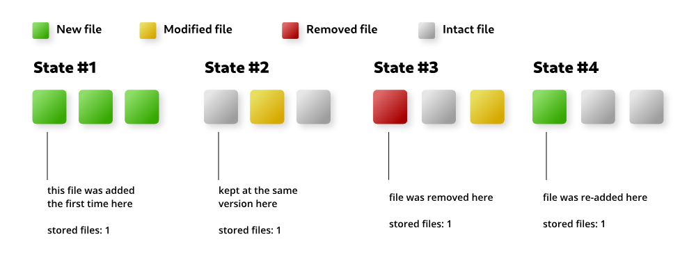
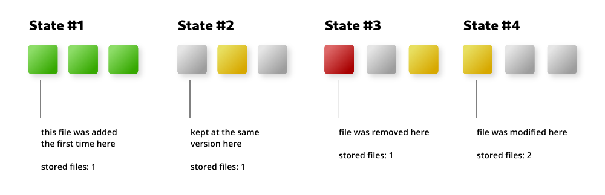

# FVS

> [!IMPORTANT]
> **This project is deprecated in favor of [FVS v2](https://github.com/fvs-lab/fvs2).**
>
> FVS has been rewritten from scratch in Go as **[fvs-lab/fvs2](https://github.com/fvs-lab/fvs2)**,
> with a proper CLI, branches, checkout, a background daemon and `mount`/`unmount` support.
>
> This repository is kept for historical reference only and is no longer maintained.
> Please use **[FVS v2](https://github.com/fvs-lab/fvs2)** going forward.

---

File Versioning System with hash comparison and data storage to create unlinked
states that can be deleted.

The original FVS (this repository) was a small Python library born to provide a
simple, deduplicated, state-based versioning system for projects like
[Bottles](https://github.com/bottlesdevs/Bottles). The idea, organizing file
versions into *states* (recovery points) that share storage through
deduplication, lives on (redesigned and greatly expanded) in
**[FVS v2](https://github.com/fvs-lab/fvs2)**.

## Concept

With the following images we can see the basic concept of FVS and how it works.

As you can see, the first file was added, removed and re-added but FVS always
kept only one copy of that file as it was always the same version.

The example above shows a different timeline. In State #4 a new file has been
added in the same place as the one in State #1 but since it is a different
file, FVS is keeping two files in its storage.
